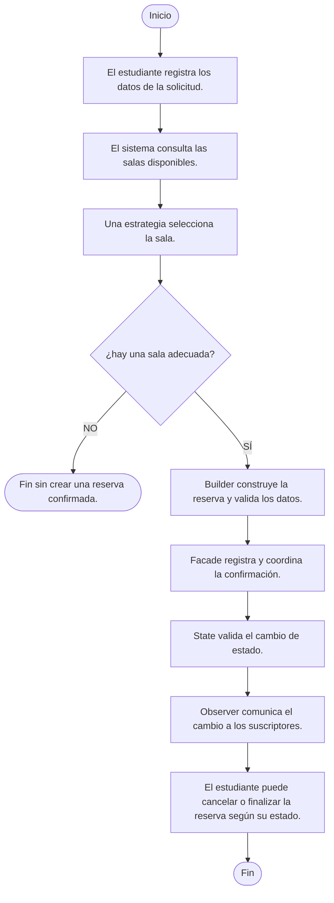

# Estación 1. Comprender el problema y modelar el flujo

## Diagrama de flujo

Cada cambio solicitado en el último paso también se valida mediante State y, si se acepta, se comunica mediante Observer. Una transición rechazada conserva el estado y no genera notificación.

## Responsabilidades que deben separarse de Main

1. Consultar las salas disponibles: RepositorioSalas y RepositorioSalasMemoria.
2. Seleccionar la sala según el criterio: EstrategiaSeleccionSala, SeleccionPorCapacidad y SeleccionSalaPreferida.
3. Construir la reserva y validar sus datos: ReservaBuilder.
4. Registrar las reservas: RepositorioReservas y RepositorioReservasMemoria.
5. Coordinar la consulta, selección, construcción, registro y confirmación: ReservaFacade.
6. Controlar las transiciones permitidas: EstadoReserva, Pendiente, Confirmada, Cancelada y Finalizada.
7. Comunicar los cambios y responder a los eventos: Reserva, ObservadorReserva, NotificadorEstudiante y RegistroEventos.

## Cohesión y mantenimiento

Si Main consultara salas, validara datos, construyera reservas, notificara y controlara estados, reuniría responsabilidades con objetivos y motivos de cambio diferentes. Tendría baja cohesión porque sus operaciones no se concentrarían en una sola responsabilidad.

Modificar una regla de selección, una validación o una notificación obligaría a editar la misma clase, dificultaría comprobar cada comportamiento de forma aislada y aumentaría el riesgo de alterar otras tareas. Separar estas responsabilidades permite localizar las reglas y mantener cada componente por su propia razón de cambio. Main configura las dependencias y presenta el flujo de la aplicación.
