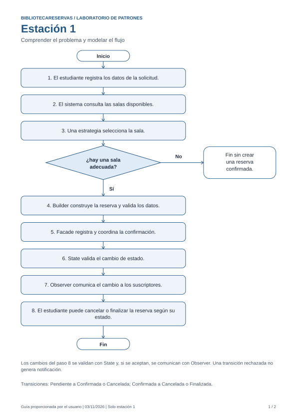

# BibliotecaReservas

Laboratorio de patrones de diseño en Java 17 o superior, basado en las capturas de la guía proporcionada. Repositorio: <https://github.com/Alejoms09/Diana-trabajo>.

## Estación 1: comprender el problema y modelar el flujo

- [Desarrollo y comparación con la guía](docs/estacion-01/estacion-01.md).
- [Diagrama de flujo editable en Mermaid](docs/estacion-01/flujo.mmd).
- [Diagrama de flujo en SVG](docs/estacion-01/flujo.svg).
- [Documento PDF de la estación](output/pdf/estacion-01.pdf).
- [Registro de las comprobaciones realizadas](docs/estacion-01/verificacion.txt).
- [Bitácora de modificaciones](BITACORA.md).



## Trabajo por estaciones

| Estación | Rama prevista | Alcance |
| --- | --- | --- |
| 1 | `estacion-01` | Diagrama, responsabilidades y cohesión de Main. |
| 2 | `estacion-02` | Estudiante, Sala y primera versión de Main. |
| 3 | `estacion-03` | Construcción con Builder. |
| 4 | `estacion-04` | Selección con Strategy. |
| 5 | `estacion-05` | Repositorios y Facade. |
| 6 | `estacion-06` | Notificaciones con Observer. |
| 7 | `estacion-07` | Ciclo de vida con State. |
| 8 | `estacion-08` | Integración y validación final. |

Cada estación se desarrolla a partir de la anterior y debe tener su propio commit, rama publicada y seguimiento remoto. La siguiente estación requiere autorización del usuario. No integrar en `main` hasta la revisión final. Esta tabla es una planificación; no acredita la ejecución ni la publicación de estaciones pendientes.

La estación 1 es documental y precede a la programación. No contiene clases Java ni exige compilar o ejecutar Main. Las pruebas de Java se incorporan en sus estaciones correspondientes.

El prototipo utilizará disponibilidad simulada con cuatro salas: A (2), B (4), C (6) y D (8). No contempla agenda real, solapamientos, interfaz gráfica ni persistencia entre ejecuciones.

## Reproducir los documentos

El script `scripts/generar_documentacion_estacion_01.py` crea el SVG y el PDF. Requiere Python y ReportLab, usados únicamente para la documentación; no son dependencias del proyecto Java. Ejecutar desde la raíz del repositorio:

```powershell
python scripts/generar_documentacion_estacion_01.py
```

Las dos capturas originales relevantes se conservan sin modificaciones en `docs/estacion-01/fuentes/`. Sus hashes se registran en `verificacion.txt`.
